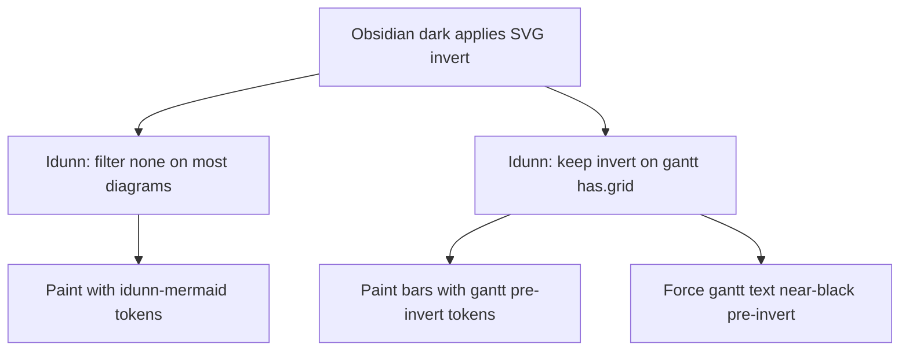

# Reference: Mermaid CSS

**Scope:** Idunn color tokens and CSS selectors for Mermaid diagrams in Obsidian (flowchart, sequence, quadrant, pie, gantt, timeline).  
**When to use:** Looking up which token or selector paints a diagram part, or adding a new Mermaid color. Source of truth: `src/mermaid.css` → `npm run build` → `theme.css`.

HTML preview `previews/mermaid-style-less.html` uses Mermaid `themeVariables` for browser demos. The shipped Obsidian theme paints via CSS overrides below — do not assume preview `themeVariables` alone match vault rendering.

## Tokens

Defined on `.theme-dark` / `.theme-light` in `src/mermaid.css` (not in `tokens.css`).

### Diagram chrome (`--idunn-mermaid-*`)

| Token | Dark | Light | Role |
|-------|------|-------|------|
| `--idunn-mermaid-panel` | `#2a2e36` | `#eef2f7` | Node / actor / timeline fill |
| `--idunn-mermaid-raised` | `#32363f` | `#f4f5f7` | Cluster / activation fill |
| `--idunn-mermaid-border` | `#3c3c3c` | `#d0d7e2` | Alias source for gantt border (light) |
| `--idunn-mermaid-label-bg` | `transparent` | `transparent` | Edge-label chip background |
| `--idunn-mermaid-fg` | `#e8e8e8` | `#1f2937` | Labels, SVG `text` / `tspan`, HTML `color` |
| `--idunn-mermaid-muted` | `#8b919a` | `#64748b` | Flowchart edges, pie slice 4, timeline connectors |
| `--idunn-mermaid-teal` | `#4ec9b0` | `#0f766e` | Flowchart node/cluster stroke |
| `--idunn-mermaid-screen-teal` | `#5bb9a8` | `#0f766e` | Sequence / quadrant / pie / timeline primary stroke |
| `--idunn-mermaid-steel` | `#5a7a90` | `#475569` | Pie slice 2, timeline lane 1 |
| `--idunn-mermaid-blue` | `#569cd6` | `#1d4ed8` | Timeline lane 2 |
| `--idunn-mermaid-link` | `#4daafc` | `#1d4ed8` | Pie slice 3, timeline lanes 3–7 |
| `--idunn-mermaid-accent` | `#0078d4` | `#2563eb` | Alias source for gantt crit (light) |
| `--idunn-mermaid-on-bar` | `#1a1a1a` | `#f8fafc` | Reserved; unused by current rules |

### Gantt paints (`--idunn-mermaid-gantt-*`)

Dark values are **pre-invert** (light-family hex): Obsidian keeps SVG `filter: invert(…)` on gantt, so these paints become dark Idunn teal/steel/blue after the filter. Light values alias the diagram tokens above.

| Token | Dark (pre-invert) | Light | Role |
|-------|-------------------|-------|------|
| `--idunn-mermaid-gantt-panel` | `#eef2f7` | `var(--idunn-mermaid-panel)` | Section / task base fill |
| `--idunn-mermaid-gantt-raised` | `#f4f5f7` | `var(--idunn-mermaid-raised)` | Alternate section / done wash base |
| `--idunn-mermaid-gantt-border` | `#d0d7e2` | `var(--idunn-mermaid-border)` | Grid ticks, exclude-range |
| `--idunn-mermaid-gantt-teal` | `#0f766e` | `var(--idunn-mermaid-screen-teal)` | Default task stroke; light titles |
| `--idunn-mermaid-gantt-steel` | `#475569` | `var(--idunn-mermaid-steel)` | Done fill mix |
| `--idunn-mermaid-gantt-link` | `#1d4ed8` | `var(--idunn-mermaid-link)` | Active task; today line |
| `--idunn-mermaid-gantt-accent` | `#2563eb` | `var(--idunn-mermaid-accent)` | Crit task |
| `--idunn-mermaid-gantt-muted` | `#64748b` | `var(--idunn-mermaid-muted)` | Done stroke |

### Hardcoded paints (not tokens)

| Value | Where | Role |
|-------|-------|------|
| `#111111` | Dark gantt `text` / `tspan` / `foreignObject` | Pre-invert ink → white after SVG filter |
| `#fff5ad` / `#decc93` | Sequence `.note` fill / stroke | Pale yellow note card |
| `#1f2937` | Sequence `.noteText` | Dark text on note |

## Obsidian invert model

| Mode | Diagram | SVG filter | How colors are set |
|------|---------|------------|--------------------|
| Dark | Flowchart, sequence, quadrant, pie, timeline | `none` | Normal `--idunn-mermaid-*` |
| Dark | Gantt (`:has(.grid)`) | `invert(100%) hue-rotate(180deg) saturate(1.25)` | `--idunn-mermaid-gantt-*` + text `#111111` |
| Light | All six | none | Tokens as listed; gantt aliases diagram tokens |

Gantt detection uses `:has(.grid)` so timeline (no `.grid`) stays painted without invert.

## Shared labels

Applies across diagrams that emit HTML labels or generic SVG text.

| Element | Selectors | Properties | Token / value |
|---------|-----------|------------|---------------|
| Node / cluster / pie title HTML | `.nodeLabel`, `.edgeLabel`, `.label`, `.cluster-label`, `.pieTitleText`, `foreignObject`, `foreignObject div/span` | `color` | `--idunn-mermaid-fg` |
| SVG text | `.nodeLabel`, `.cluster-label`, `.label`, `.pieTitleText`, `.nodeLabel tspan`, `text` | `fill` | `--idunn-mermaid-fg` |
| Edge-label chip | `.edgeLabel` | `background-color`, `color` | `--idunn-mermaid-label-bg`, `--idunn-mermaid-fg` |
| Edge-label rect | `.edgeLabel rect`, `.labelBkg` | `fill`, `opacity` | `label-bg`, `opacity: 0` |

Set both `fill` (SVG) and `color` (HTML/`foreignObject`) when changing label ink.

## Flowchart (S3)

| Element | Selectors | Properties | Token / value |
|---------|-----------|------------|---------------|
| Node shapes | `.node rect/circle/ellipse/polygon/path` | `fill`, `stroke` | `panel`, `teal` |
| Cluster | `.cluster rect` | `fill`, `stroke` | `raised`, `teal` |
| Edges | `.edgePath .path`, `.flowchart-link` | `stroke` | `muted` |
| Arrowheads | `.edgePath .arrowheadPath`, `marker#flowchart-pointEnd/Start` (+ `path`), `.marker.flowchart-pointEnd/Start` | `fill`, `stroke` | `muted` |
| Generic markers | `svg[id*="mermaid"] marker.path`, `.flowchart marker path` | `fill`, `stroke` | `muted` |

## Sequence (S4)

| Element | Selectors | Properties | Token / value |
|---------|-----------|------------|---------------|
| Actor box | `.actor` | `fill`, `stroke` | `panel`, `screen-teal` |
| Lifelines | `.actor-line`, `.actor-man line` | `stroke` | `screen-teal` |
| Messages | `.messageLine0`, `.messageLine1` | `stroke` | `screen-teal` |
| Sequence number | `.sequenceNumber` | `fill` | `fg` |
| Activations | `.activation0`–`.activation2` | `fill`, `stroke` | `raised`, `screen-teal` |
| Arrowheads / person | `[id$="arrowhead"] path`, `marker#arrowhead/crosshead/sequencenumber path`, `.actor-man circle` | `fill`, `stroke` | `screen-teal` |
| Actor / message / loop text | `text.actor`, `text.actor-box`, `text.actor-man`, `.messageText`, `.labelText`, `.loopText` (+ `> tspan`) | `fill`, `color` | `fg` |
| Note card | `.note` | `fill`, `stroke` | `#fff5ad`, `#decc93` |
| Note text | `.noteText` (+ `> tspan`) | `fill`, `color` | `#1f2937` |

Override `tspan` as well as `text` — Mermaid often sets fill on the tspan only.

## Quadrant (S4)

| Element | Selectors | Properties | Token / value |
|---------|-----------|------------|---------------|
| Borders / axes | `.quadrant .border`, `.quadrant-border`, `.quadrants line`, `svg[aria-roledescription="quadrant-chart"] > g > rect` | `stroke` | `screen-teal` |
| Points | `.quadrant-point`, `.data-point circle`, `circle.quadrant-point` | `fill`, `stroke` | `screen-teal` |
| Titles | `.quadrantChart text[class*="title"]`, `text.quadrant-title` | `fill` | `screen-teal` |

Quadrant **fills** (`quadrant1`–`4` / fill rects) are not painted in theme CSS. Preview HTML may set them via `themeVariables` only.

## Pie (S4)

Slice and legend swatch stay paired by `nth` index.

| Element | Selectors | Properties | Token / value |
|---------|-----------|------------|---------------|
| Slice / legend 1 | `.pieCircle:nth-of-type(1)`, `path.pieCircle:nth-of-type(1)`, `g.legend > g:nth-child(1) rect` | `fill` | `screen-teal` |
| Slice / legend 2 | `…:nth-of-type(2)` / `nth-child(2)` | `fill` | `steel` |
| Slice / legend 3 | `…:nth-of-type(3)` / `nth-child(3)` | `fill` | `link` |
| Slice / legend 4 | `…:nth-of-type(4)` / `nth-child(4)` | `fill` | `muted` |
| Title / slice / legend text | `.pieTitleText`, `.slice`, `.legend text` | `fill` | `fg` |

Slices 5+ have no Idunn rule (Mermaid defaults).

## Gantt (S5)

All bar/section rules are scoped with `:has(.grid)`. Layout helpers (tick thinning, grid path) are size/opacity only.

| Element | Selectors | Properties | Token / value |
|---------|-----------|------------|---------------|
| Exclude range | `.exclude-range` | `fill`, `opacity` | `gantt-border`, `0.35` |
| Section stroke | `.section` | `stroke` | `none` |
| Sections 0, 2 | `.section0`, `.section2` | `fill`, `opacity` | `gantt-raised`, `0.45` |
| Sections 1, 3 | `.section1`, `.section3` | `fill`, `opacity` | `gantt-panel`, `0.35` |
| Titles (light only) | `.sectionTitle`, `.sectionTitle0`–`3`, `.titleText` (+ tspan) | `fill` | `gantt-teal` |
| Grid ticks | `.grid .tick` | `stroke` | `gantt-border` |
| Today line | `.today` | `stroke` | `gantt-link` |
| Default task | `.task0`–`.task3` | `fill`, `stroke` | `color-mix(teal 14%, panel)`, `gantt-teal` |
| Active | `.active0`–`.active3` | `fill`, `stroke` | `color-mix(link 26%, panel)`, `gantt-link` |
| Done | `.done0`–`.done3` | `fill`, `stroke` | `color-mix(steel 12%, raised)`, `gantt-muted` |
| Crit | `.crit0`–`.crit3` | `fill`, `stroke` | `color-mix(accent 30%, panel)`, `gantt-accent` |
| Task / axis text (light) | `[class*="taskText"]`, `[class*="doneText"]`, `[class*="activeText"]`, `[class*="critText"]`, `.grid .tick text` | `fill`, `color` | `--idunn-mermaid-fg` |
| All text (dark) | `:has(.grid) text`, `tspan`, `foreignObject` | `fill`, `color` | `#111111` (then invert → white) |

Axis dates: hide ticks `nth-child(3n+1)` and `3n+2`; show `3n` only (`font-size: 10px` on tick text).

**Dark gantt color edits:** change `--idunn-mermaid-gantt-*` (light-family hex), not `--idunn-mermaid-panel` / dark diagram tokens. Those would invert to the wrong lightness.

## Timeline (S5)

No SVG invert. First lane is often `.section--1` / `.timeline-node`.

| Element | Selectors | Properties | Token / value |
|---------|-----------|------------|---------------|
| Event wrapper | `.eventWrapper` | `filter` | `none` |
| Connectors | `.lineWrapper line`, `.timeline-node + .lineWrapper line`, `.edge` | `stroke` | `muted` |
| Lane 0 / root / timeline-node | `.timeline-node` shapes; `.section--1`, `.section-root`, `.section-0` shapes; `.section-type-0`, `.task-type-0` | `fill`, `stroke` | `panel`, `screen-teal` |
| Lane 1 | `.section-1` shapes; `.section-type-1`, `.task-type-1` | `fill`, `stroke` | `panel`, `steel` |
| Lane 2 | `.section-2` shapes; `.section-type-2`, `.task-type-2` | `fill`, `stroke` | `panel`, `blue` |
| Lanes 3–7 | `.section-3`–`.section-7` shapes; `.section-type-N`, `.task-type-N` | `fill`, `stroke` | `panel`, `link` |
| Node / event text | `.timeline-node`, `.section--1`, `.section-0`–`7`, `.section-root`, `.eventWrapper`, `.taskWrapper` `text` (+ tspan) | `fill`, `color` | `fg` |
| Lane lines 0–3 | `.section--1` / `.section-0`–`3` `line` | `stroke` | `muted` |
| Section edges | `.section-edge--1`, `.section-edge-0`–`3` | `stroke` | `screen-teal` |
| Main line | `.lineWrapper > line` | `stroke` | `screen-teal` |

## How to define a new color

1. Add or change a token under `.theme-dark` and `.theme-light` in `src/mermaid.css`.  
   - Shared diagram chrome → `--idunn-mermaid-*`.  
   - Gantt (especially dark) → also set `--idunn-mermaid-gantt-*` (dark = pre-invert light-family hex; light can `var()`-alias).
2. Bind the Mermaid class with `fill` / `stroke` / `color` as needed. Use `!important` where Mermaid injects `#svgId … !important` or inline fills.
3. For HTML labels (`foreignObject`, `.nodeLabel`), set `color`. For sequence/gantt SVG labels, set `tspan` as well as `text`.
4. Run `npm run build` and confirm `theme.css` updated.
5. Verify Dark + Light in Obsidian (copy `theme.css`, reload theme). Prefer preview HTML for quick iteration, then vault for invert/gantt truth.

Do not put Mermaid-only hex into `src/tokens.css` unless it becomes a shared brand token.

## Coverage gaps

Documented for future CSS work — not currently styled in Idunn:

| Diagram | Unstyled / weak |
|---------|-----------------|
| Sequence | `.loopLine`, `.labelBox` / fragment boxes, `.noteGroup`, `.activation3+` |
| Quadrant | Quadrant fill regions (`quadrant1`–`4`) |
| Pie | Slice / legend 5+; outer circle |
| Gantt | Combined states (`.activeCrit*`, `.doneCrit*`), `.milestone*` |
| Timeline | `.section-8+`, `.section-edge-4+`, `.section-N line` beyond 3 |

## Related

- [How to: tune Mermaid](../how-to/tune-mermaid.md)
- [CSS variable map](css-variable-map.md)
- [Design tokens](design-tokens.md)
- Preview: `previews/mermaid-style-less.html`
- Agent skill: `.cursor/skills/extend-theme/SKILL.md`
